

  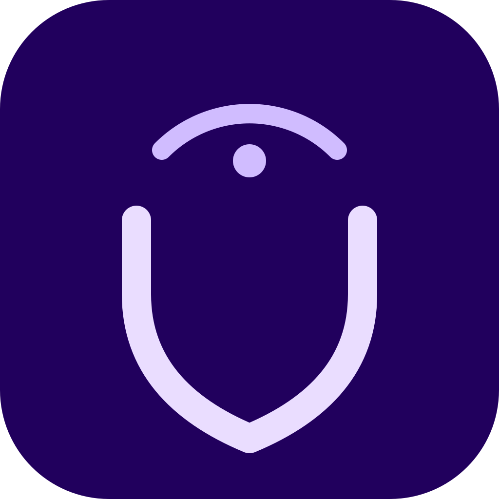

<h1 align="center">Pocket Upwatch</h1>

Keep an eye on your websites, APIs, and home servers from your Android device.

  <a href="https://github.com/WardPearce/PocketUpwatch/releases/latest">Download for Android</a> ·
  <a href="#screenshots">Screenshots</a> ·
  <a href="CHANGELOG.md">What's new</a>

Pocket Upwatch checks whether your services are reachable, tracks how they respond, and alerts you when something goes down or recovers. No account or hosted monitoring service is required. Your monitors and history stay on your device unless you choose to export them.

**Requires Android 8.0 or newer.**

## Features

- **See what needs attention.** Clear UP, DOWN, unknown, and paused states, with search, tags, filters, and sorting.
- **Look back over time.** Availability and response-time charts, recent checks, and an incident history help you understand outages.
- **Choose when to be alerted.** Set how many failures confirm an outage, receive recovery alerts, and add repeat reminders. Quiet hours and snooze mute alerts while checks continue; maintenance pauses checks and alerts.
- **Check on your schedule.** Choose intervals from 5 minutes to 24 hours, test a service immediately, or pause individual monitors or the whole list.
- **Monitor your home network.** Check local servers and devices, including networks without Internet access.
- **Go beyond a connection check.** Check for an expected website or API response, use authentication, and get certificate-expiry warnings.
- **Write response checks comfortably.** Edit JSON, YAML/YML, XML, or plain text with syntax highlighting, line numbers, undo/redo, and a larger editor. Validate or preview formatting before applying it. JSON and YAML checks ignore formatting and key order; XML offers an optional indentation rule.
- **Manage requests easily.** Add and remove headers individually, and start or end maintenance right from a service page.
- **Keep useful shortcuts nearby.** Add home-screen widgets for an overview or an individual service, and pause or resume monitoring from Quick Settings.
- **Use the extra space.** Tablets and unfolded foldables show the monitor list beside service details, with a settings sidebar and wider forms and charts. Narrow windows keep the familiar phone layout.
- **Make it yours.** Choose light, dark, or system theme, compact or comfortable lists, time displays, and defaults for new monitors.
- **Back up and share.** Create password-protected backups, export templates with private fields removed, review imports, and export check or incident history as CSV. Optional reminders help you keep backups current.

## What can I monitor?

| Service | What Pocket Upwatch checks |
| --- | --- |
| Websites and APIs (HTTP/HTTPS) | Whether a request succeeds, with optional checks for the response you expect |
| Network ports (TCP) | Whether a connection can be opened to a service |
| Devices and hosts (Ping) | Whether a host responds; some networks block ping |
| Domain names (DNS) | Whether a name resolves, optionally matching expected IP addresses |
| Certificates (TLS) | Whether a certificate is trusted and how soon it expires |

## Screenshots

Dark-mode app previews with sample monitors and data. Select an image to view it at full size.

| Overview | Add a monitor | Availability and response times |
| :---: | :---: | :---: |
| <a href="previews/overview-dark.png">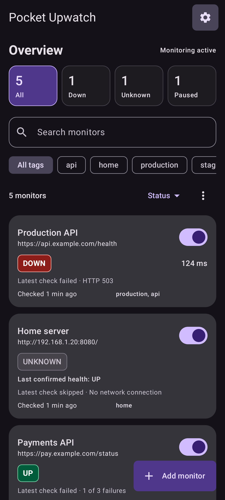</a> | <a href="previews/add-monitor-dark.png">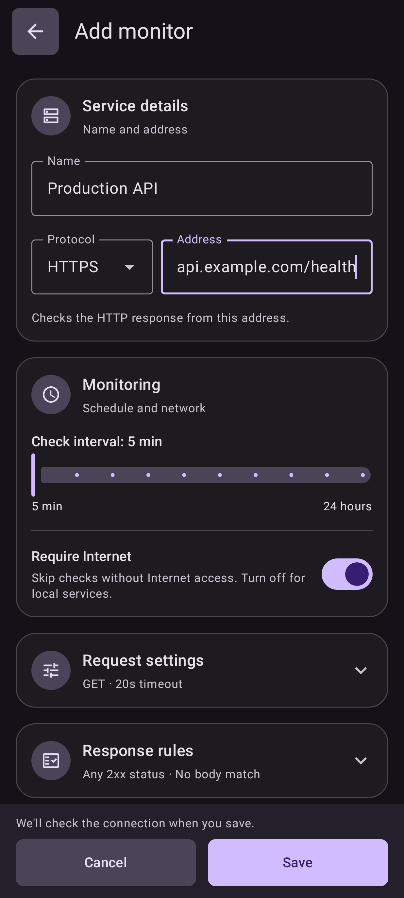</a> | <a href="previews/history-dark.png">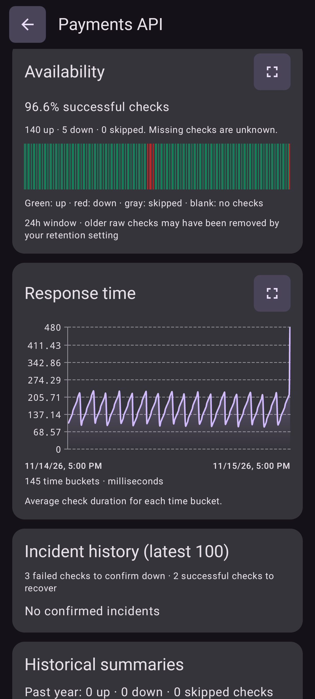</a> |

| Settings | Backup and restore | Notifications and quiet hours |
| :---: | :---: | :---: |
| <a href="previews/settings-dark.png">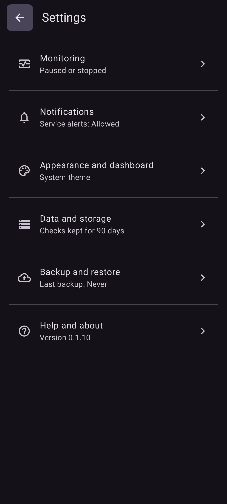</a> | <a href="previews/backup-dark.png">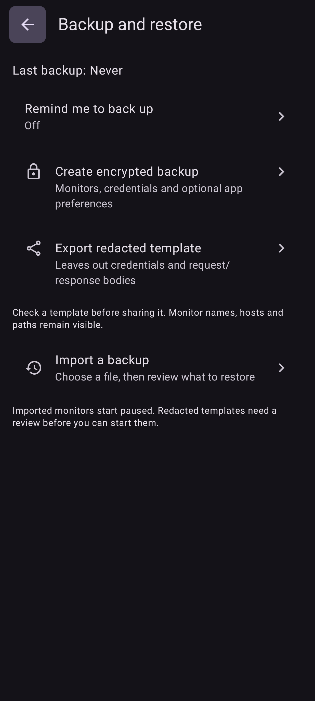</a> | <a href="previews/notifications-dark.png">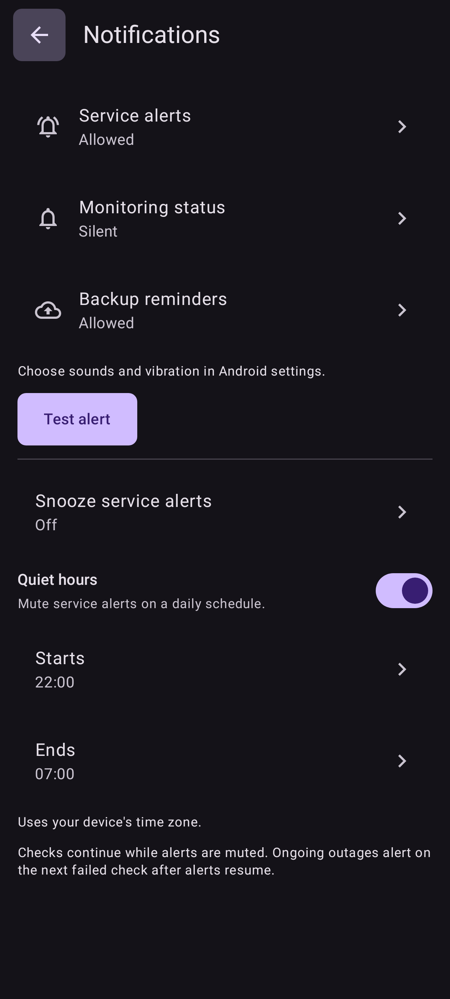</a> |

| Response editor | Custom headers |
| :---: | :---: |
| <a href="previews/phone-response-editor-dark.png">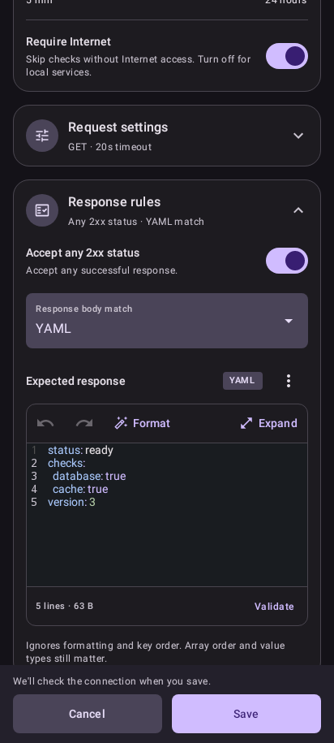</a> | <a href="previews/custom-headers-dark.png">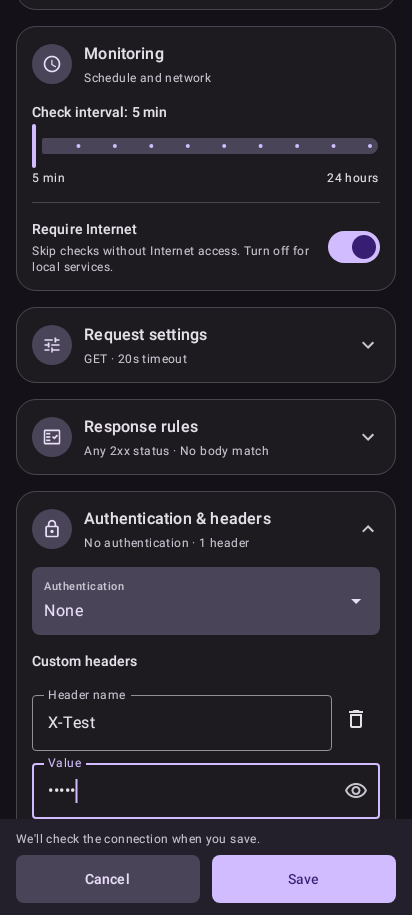</a> |

### Tablets and foldables

| Monitor workspace | Settings sidebar |
| :---: | :---: |
| <a href="previews/tablet-overview-dark.png">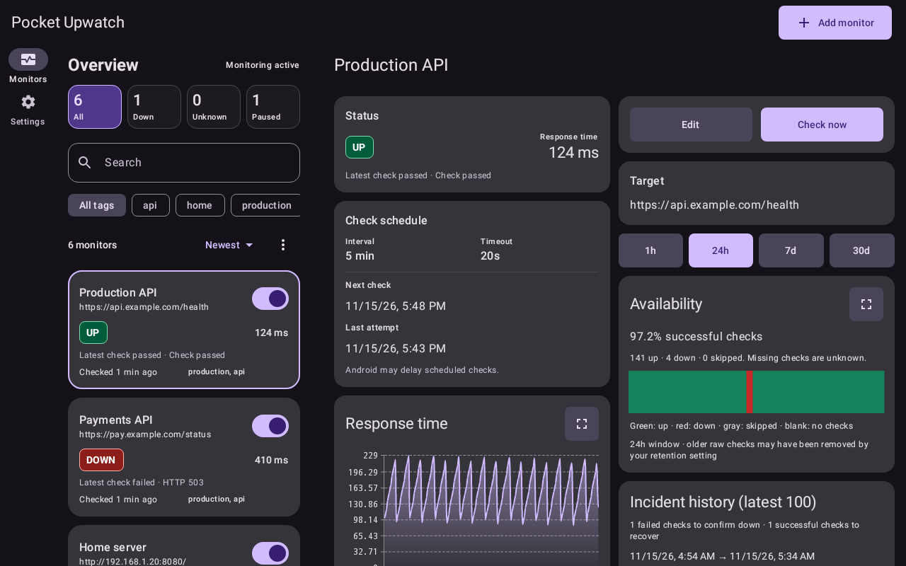</a> | <a href="previews/tablet-settings-dark.png">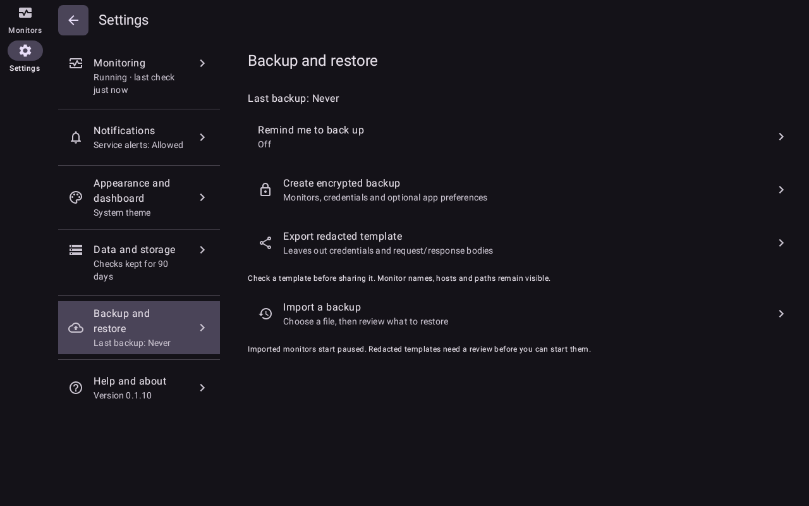</a> |

[Expected response on a tablet](previews/tablet-expected-response-dark.png) · [Maintenance controls](previews/maintenance-dark.png)

More views: [tablet editor](previews/tablet-editor-dark.png) · [portrait tablet](previews/tablet-portrait-dark.png) · [unfolded foldable](previews/foldable-unfolded-dark.png) · [tabletop fold](previews/foldable-tabletop-dark.png).

## Get started

1. Download the APK from [Releases](https://github.com/WardPearce/PocketUpwatch/releases/latest) and install it on your Android device.
2. Open the app and follow the permission setup for notifications, battery use, and alarms.
3. Tap **Add monitor**, give it a name, and enter its address. Pasting `https://example.com` selects HTTPS automatically.
4. Choose a check interval and tap **Save**. The app checks the connection first. If the service is unavailable, you can save it paused and start it later.

For a local service without Internet access, turn off **Require Internet** in its monitor settings.

## Your data and background checks

Configuration and history are stored on your device. Saved authentication headers and credentials are encrypted on the device. Encrypted backups can include credentials and app preferences; templates leave out private fields but still show monitor names, hosts, and paths, so review them before sharing.

Checks run from your device and use its network connection. Android may delay them, especially when battery restrictions apply. Missing or skipped checks are shown as unknown, and availability percentages describe completed checks rather than guaranteed continuous uptime.

In **Settings**, you can check background monitoring health, test alerts, choose how long to keep history, and clean up old checks.

## Help and project information

- [Report a problem or suggest a feature](https://github.com/WardPearce/PocketUpwatch/issues)
- [Read the release notes](CHANGELOG.md)
- [Development, detailed behavior, and release instructions](AGENT.md)
